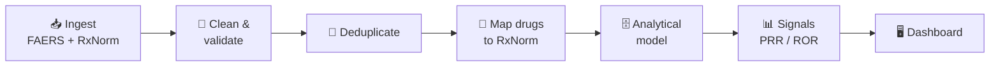
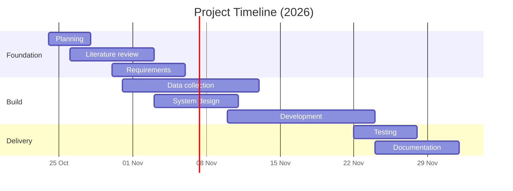

# 💊 Drug-Safety Intelligence Platform

### Project Documentation

*From raw FDA adverse-event reports to clean, standardized, analysis-ready drug-safety data.*

**Digital Egypt Pioneers Initiative (DEPI) · Graduation Project**

[Contents](#-contents) · [Overview](#-overview) · [Pipeline](#-pipeline) · [Targets](#-key-targets) · [Timeline](#timeline) · [Team](#team)

> [!IMPORTANT]
> **Disclaimer:** This platform analyzes *reported* adverse events. It does not establish causation, provide medical advice, or replace professional pharmacovigilance.

---

## 📚 Contents

| Document | Description |
|:---------|:------------|
| [**Project Documentation (PDF)**](final_documentation.pdf) | Planning, literature review, requirements, and references in one document |

### What's inside

| # | Section | Covers |
|:-:|:--------|:-------|
| 1 | **Project Planning & Management** | Overview, problem statement, objectives, scope, timeline, milestones, team roles, risks, success metrics |
| 2 | **Literature Review** | FAERS and RxNorm, similar systems (openFDA, OpenVigil, AEOLUS, VigiBase), comparison, research gap |
| 3 | **Requirements Gathering** | Stakeholders, functional and non-functional requirements, data and technical requirements, constraints, acceptance criteria |

---

## 🎯 Overview

The platform ingests adverse-event reports from the **FDA FAERS** system, standardizes drug names using **RxNorm**, removes duplicate reports, and presents reporting patterns through an **interactive dashboard**. An AI component is planned on top of this core.

| | |
|:--|:--|
| **Goal** | An end-to-end data pipeline that turns raw FAERS reports into a clean, standardized dataset with a searchable dashboard |
| **Stack (planned)** | Python · SQL · PostgreSQL · dbt · OHDSI Usagi · Parquet · Docker |
| **AI (planned)** | One team member will explore AI features (e.g. drug-name matching, data exploration). Scope to be defined. |
| **Out of scope** | Diagnosis · medication recommendations · causal inference · clinical risk prediction · drug–drug interaction checking |

---

## 🔄 Pipeline

---

## 📈 Key Targets

| Metric | Target |
|:-------|:------:|
| RxNorm mapping rate | **≥ 90%** |
| Duplicate removal | **≥ 95%** |
| Search response time | **< 3 s** |
| Signal detection accuracy | **≥ 80%** |
| Test pass rate | **≥ 90%** |

---

## 🗓️ Timeline

**24 October – 1 December 2026**

| Milestone | Date | Deliverable |
|:----------|:----:|:------------|
| **M1** Project kickoff | 27 Oct | Approved scope and plan |
| **M2** Literature review | 2 Nov | Review section and references |
| **M3** Requirements approved | 5 Nov | Requirements specification |
| **M4** Design approved | 10 Nov | Architecture and UI mockups |
| **M5** Clean dataset ready | 12 Nov | FAERS cleaned and mapped to RxNorm |
| **M6** First prototype | 17 Nov | Working prototype (search, signals) |
| **M7** Testing complete | 27 Nov | Test report and fixes |
| **M8** Final documentation | 1 Dec | Final PDF uploaded to GitHub |

---

## Team

**Team Leader:** Youssef Asaad Saad

| Member | GitHub | Role | Documentation Sections |
|:-------|:-------|:-----|:-----------------------|
| **Youssef Saad** | [@Usf132](https://github.com/Usf132) | Team Leader · AI Engineer | 2.1 – 2.3 (Literature review: introduction, data sources, similar systems) |
| **Randa Gomaa** | [@ran-da25](https://github.com/ran-da25) | Team Member | 1.1 – 1.4 (Overview, problem statement, objectives, scope) |
| **Mariam Abdelaziz** | [@MariamAbdelaziz21](https://github.com/MariamAbdelaziz21) | Team Member | 1.5 – 1.9 (Timeline, milestones, team roles, risks, success metrics) |
| **Olivia Hanna** | [@ohanna725](https://github.com/ohanna725) | Team Member | 2.4, 2.5, 3.1 (Comparison, research gap, stakeholders) |
| **Abanoub Ayman** | [@Abanob-Ayman](https://github.com/Abanob-Ayman) | Team Member | 3.2 – 3.7 (Functional, non-functional, data, technical requirements, constraints, acceptance criteria) |

All members also contribute to data engineering and QA. Detailed technical assignments (data engineering, backend, frontend, testing) are still to be agreed and will be added here.

---

Public, anonymized data only · Web sources accessed October 2026 · Items marked <i>planned</i> describe intended design, not completed work

